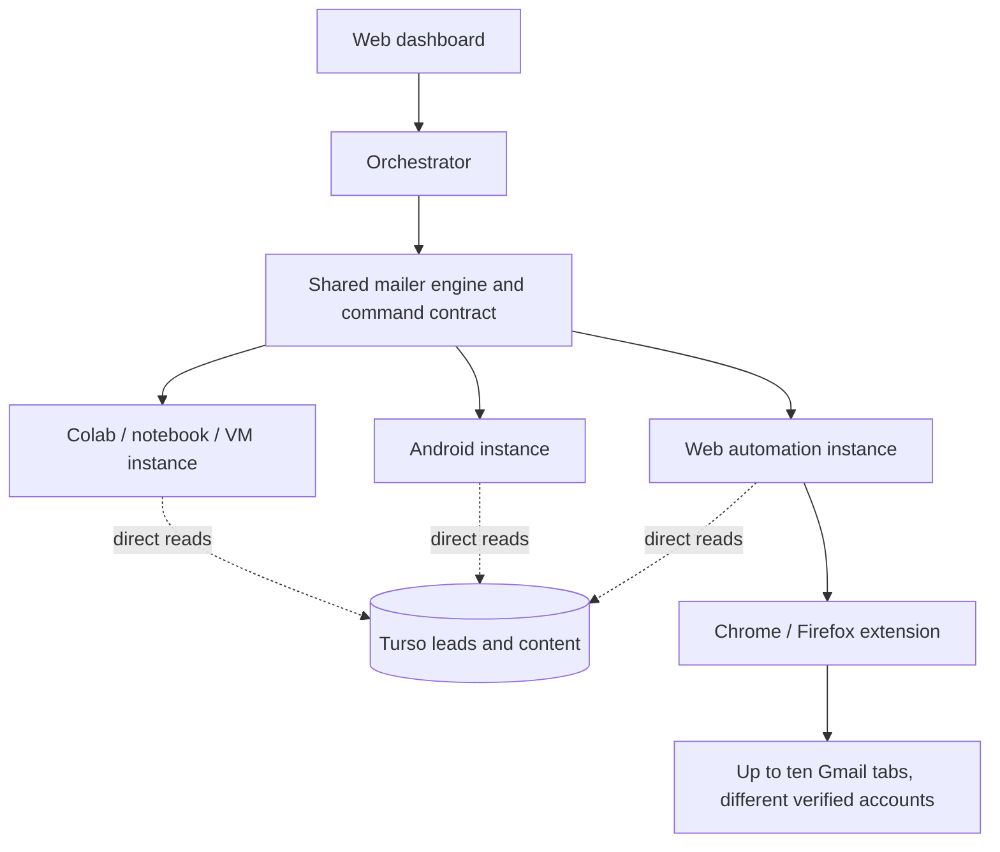
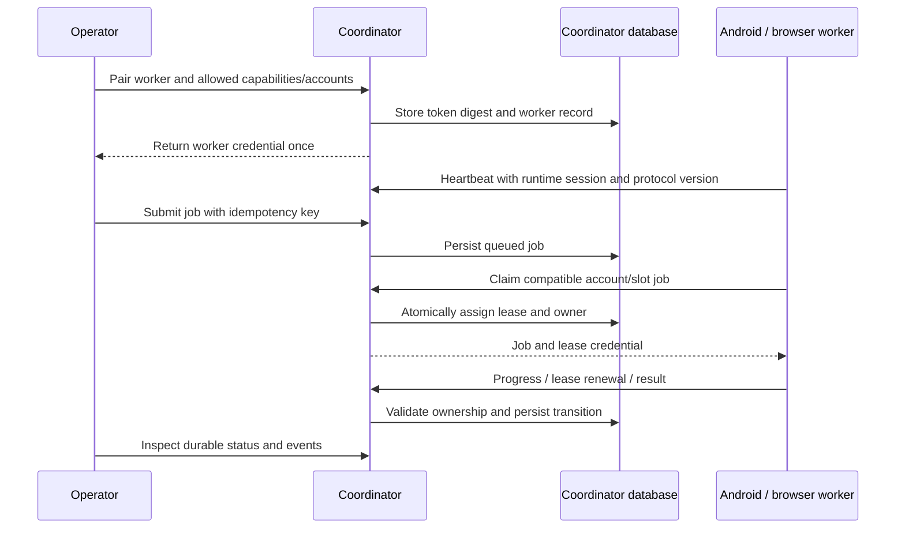
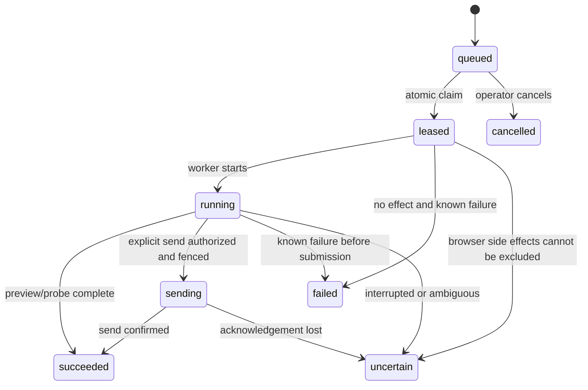

# Alphamailer Orchestrator architecture

Status: implemented fleet, Gradio connector and shared Flutter dashboard. Read
`Implementation-Status.md` for current evidence and remaining gates, `Scope.md`
for delivery boundaries, and `Agent.md` for implementation rules. The engine is
packaged read-only from the original source and integrated into Android.

## Suite relationship

The engine is shown once as a shared logical layer. It executes inside each
instance. It is not an additional central service required by standalone apps.
The existing `../Alphamailer/` remains unchanged during this independent phase.

## Concrete coordinator components

Use the [application source map](app/README.md) for exact module ownership and
the [protocol guide](contracts/v1/README.md) for canonical request models/routes.
The native [Automation Campaigns UI](../Alphamailer-automation/docs/Operations.md#campaign-import-and-cancellation)
calls existing operator endpoints; it does not introduce a separate job protocol.

| Component | Technology | Role |
| --- | --- | --- |
| HTTP application | Existing FastAPI | Legacy registry plus versioned fleet API |
| Existing dashboard | Jinja + existing static assets | Immediate operator interface |
| Common presentation | Flutter Web | Shared project with Android, mounted at /dashboard/ |
| Persistence | SQLAlchemy; SQLite / PostgreSQL | Registration, worker identity, assignments, results and events |
| Contract | Strict Pydantic models + exported JSON Schema | Versioned boundary for both clients |
| Legacy connector | Gradio Python client | Inspect and call explicitly supported runner operations |
| Device/browser transport | Authenticated outbound requests | Reach workers behind NAT without public inbound URLs |

The coordinator never sends raw operator credentials to a worker. A worker is
paired with a distinct scoped credential. Android does not need to host Gradio.
Flutter does not need to reimplement Gradio's protocol: the Python connector
handles remote Gradio calls.

## Existing versus new

Existing: `/api/instances` publication/listing, admin login/users, active URL table,
SQLite/PostgreSQL configuration. New: worker pairing, session identity, periodic
heartbeats, capability negotiation, durable commands/jobs, claims, results,
recovery, browser/device integration, and fleet dashboard views.

The old mailer currently publishes a URL at startup. Do not describe that as an
implemented periodic heartbeat. Keep the legacy payload accepted unchanged.

## Version 1 interaction

Operations are `runtime.probe`, `gmail.compose`, `gmail.draft` and `engine.command`.
Engine commands include account-bound preparation/execution and campaign controls.
Browser jobs receive frozen prepared messages. Credentials remain in each instance.

## Job state and invariants

- Unique job identity and immutable prepared content per submission.
- Idempotency conflicts reject changed requests instead of silently replacing jobs.
- One active assignment per worker slot and account; worker capacity is bounded.
- Leases are tied to worker, session and token, not merely a job ID.
- Database conditions enforce concurrency; a process-local lock is insufficient.
- Expiry/restart never means an email is safe to resend.
- Preview, draft creation, send acceptance and inbox receipt are different results.
- Cancellation does not reverse an accepted external send.

## Persistence and data ownership

The coordinator owns assignments for orchestrated jobs. Workers retain execution
journals/recovery state. Standalone local campaigns have their own scheduling
authority. Attaching a runtime must not create a second scheduler for existing
local jobs.

Turso remains the selected source of leads/content and is read directly by runtime
engines. It is not used for job leasing in this design. Distributed lead assignments
must be explicit; independent full-table reads are not a distribution mechanism.

Prepared artifacts need stable identifiers, bounded storage, integrity checks and
retention rules. Colab runtime deletion can destroy local files; long-term recovery
requires external checkpoints. A live SQLite database on a synchronized folder is
not the default distributed-storage design.

## Authentication and network boundaries

Operator API authentication and session-authenticated UI mutations are separate
from worker tokens. UI mutations require CSRF protection. A worker can only claim,
renew and report its own permitted jobs. Job/artifact payloads exclude credentials.
Public Gradio endpoints need their own access controls; protecting the registry
does not protect the remote application.

The legacy connector must not fetch arbitrary unauthenticated user URLs. Operator
configuration selects permitted runner destinations. Discovery never starts a
campaign. Contract version and capabilities govern routing; unsupported commands
are explicit errors.

## Compatibility and deployment

New fleet tables are additive. Existing registration rows, users, API paths and
URL publications continue working. Tests use temporary databases. Existing
production/local `app.db` files are not migration test fixtures.

Use a stable local/VM/server deployment for the coordinator when persistence is
needed. Colab remains a supported runner, subject to its own availability limits.
Use one coordinator process. Gradio Client sessions and live Job handles are
process-local even when PostgreSQL is configured. Multiple processes require an
explicit shared-session design and database-specific claim tests first.

## Verification boundary

Required evidence includes legacy compatibility, concurrent claims, ownership
checks, stale sessions, lease expiry, duplicate requests/reports, persistence across
new sessions/application restarts, dashboard behavior, and both client contracts.
Local fake workers establish protocol correctness only. Real Gmail and Android
execution require their own separately reported evidence.
