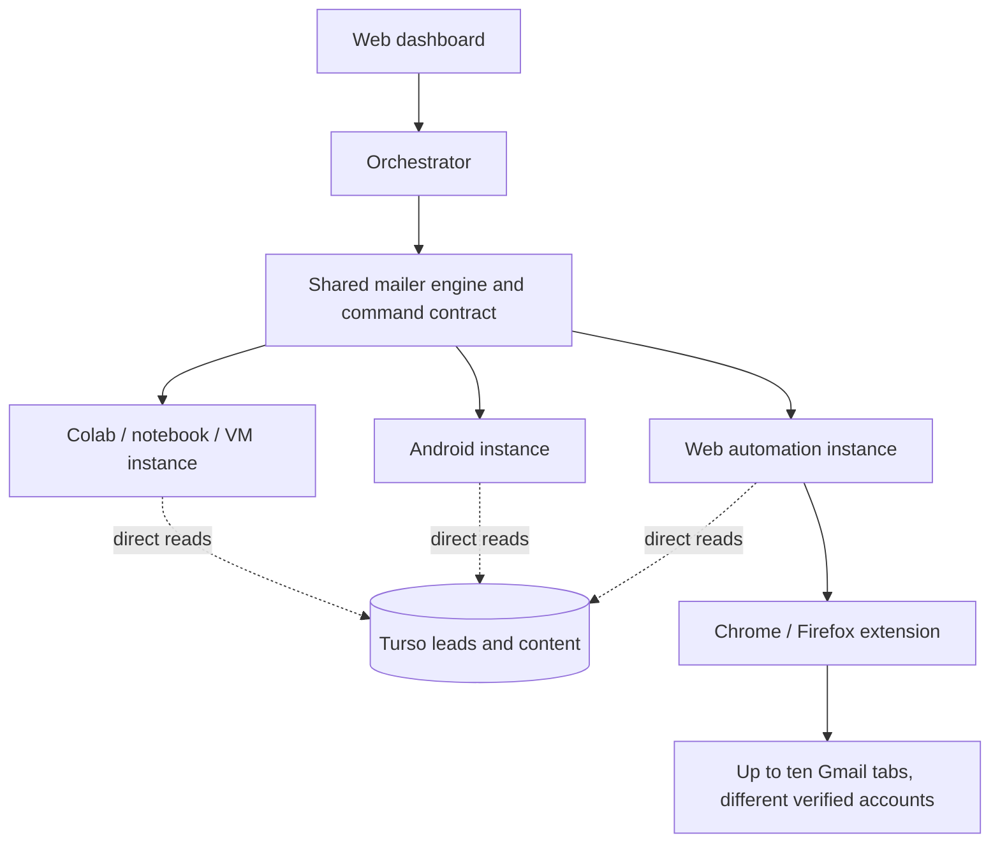
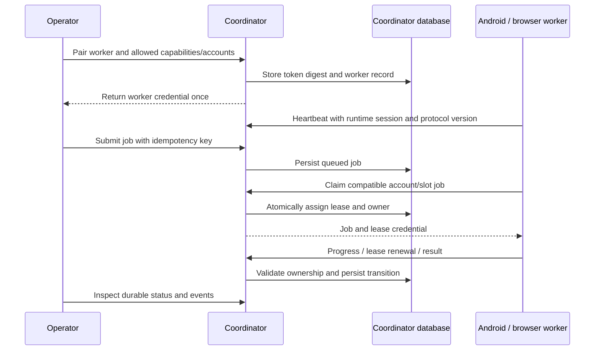
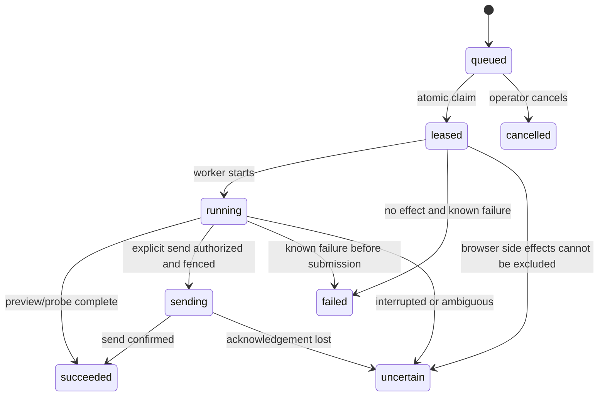

# Alphamailer Orchestrator architecture


## Consolidated sections

- [URL-registry specification](#registry-specification)

These sections now live in this document. Task IDs, unresolved requirements and dated evidence retain their original meaning. This documents-only consolidation on 2026-11-06 ran no application, provider or device tests.

Status: implemented fleet, Gradio connector and shared Flutter dashboard. Read
`Tasks.md#implementation-status` for current evidence and remaining gates, `Plan.md#scope`
for delivery boundaries, and `AGENTS.md#implementation-instructions` for implementation rules. The engine is
packaged read-only from the original source and integrated into Android.

## Suite relationship



The engine is shown once as a shared logical layer. It executes inside each
instance. It is not an additional central service required by standalone apps.
The existing `../Alphamailer/` remains unchanged during this independent phase.

## Concrete coordinator components

Use the [application source map](README.md#component-app) for exact module ownership and
the [protocol guide](README.md#component-contracts-v1) for canonical request models/routes.
The native [Automation Campaigns UI](../Alphamailer-automation/docs/Operations.md#campaign-import-and-cancellation)
calls existing operator endpoints; it does not introduce a separate job protocol.

| Component | Technology | Role |
| --- | --- | --- |
| HTTP application | Existing FastAPI | Legacy registry plus versioned fleet API |
| Existing dashboard | Jinja + existing static assets | Immediate operator interface |
| Common presentation | Flutter Web | Shared project with Android, mounted at /dashboard/ |
| Persistence | SQLAlchemy; SQLite / PostgreSQL | Registration, worker identity, assignments, results and events |
| Contract | Strict Pydantic models + exported JSON Schema | Versioned boundary for both clients |
| Legacy connector | Gradio Python client | Inspect and call explicitly supported runner operations |
| Device/browser transport | Authenticated outbound requests | Reach workers behind NAT without public inbound URLs |

The coordinator never sends raw operator credentials to a worker. A worker is
paired with a distinct scoped credential. Android does not need to host Gradio.
Flutter does not need to reimplement Gradio's protocol: the Python connector
handles remote Gradio calls.

## Existing versus new

Existing: `/api/instances` publication/listing, admin login/users, active URL table,
SQLite/PostgreSQL configuration. New: worker pairing, session identity, periodic
heartbeats, capability negotiation, durable commands/jobs, claims, results,
recovery, browser/device integration, and fleet dashboard views.

The old mailer currently publishes a URL at startup. Do not describe that as an
implemented periodic heartbeat. Keep the legacy payload accepted unchanged.

## Version 1 interaction



Operations are `runtime.probe`, `gmail.compose`, `gmail.draft` and `engine.command`.
Engine commands include account-bound preparation/execution and campaign controls.
Browser jobs receive frozen prepared messages. Credentials remain in each instance.

## Job state and invariants



- Unique job identity and immutable prepared content per submission.
- Idempotency conflicts reject changed requests instead of silently replacing jobs.
- One active assignment per worker slot and account; worker capacity is bounded.
- Leases are tied to worker, session and token, not merely a job ID.
- Database conditions enforce concurrency; a process-local lock is insufficient.
- Expiry/restart never means an email is safe to resend.
- Preview, draft creation, send acceptance and inbox receipt are different results.
- Cancellation does not reverse an accepted external send.

## Persistence and data ownership

The coordinator owns assignments for orchestrated jobs. Workers retain execution
journals/recovery state. Standalone local campaigns have their own scheduling
authority. Attaching a runtime must not create a second scheduler for existing
local jobs.

Turso remains the selected source of leads/content and is read directly by runtime
engines. It is not used for job leasing in this design. Distributed lead assignments
must be explicit; independent full-table reads are not a distribution mechanism.

Prepared artifacts need stable identifiers, bounded storage, integrity checks and
retention rules. Colab runtime deletion can destroy local files; long-term recovery
requires external checkpoints. A live SQLite database on a synchronized folder is
not the default distributed-storage design.

## Authentication and network boundaries

Operator API authentication and session-authenticated UI mutations are separate
from worker tokens. UI mutations require CSRF protection. A worker can only claim,
renew and report its own permitted jobs. Job/artifact payloads exclude credentials.
Public Gradio endpoints need their own access controls; protecting the registry
does not protect the remote application.

The legacy connector must not fetch arbitrary unauthenticated user URLs. Operator
configuration selects permitted runner destinations. Discovery never starts a
campaign. Contract version and capabilities govern routing; unsupported commands
are explicit errors.

## Compatibility and deployment

New fleet tables are additive. Existing registration rows, users, API paths and
URL publications continue working. Tests use temporary databases. Existing
production/local `app.db` files are not migration test fixtures.

Use a stable local/VM/server deployment for the coordinator when persistence is
needed. Colab remains a supported runner, subject to its own availability limits.
Use one coordinator process. Gradio Client sessions and live Job handles are
process-local even when PostgreSQL is configured. Multiple processes require an
explicit shared-session design and database-specific claim tests first.

## Verification boundary

Required evidence includes legacy compatibility, concurrent claims, ownership
checks, stale sessions, lease expiry, duplicate requests/reports, persistence across
new sessions/application restarts, dashboard behavior, and both client contracts.
Local fake workers establish protocol correctness only. Real Gmail and Android
execution require their own separately reported evidence.


<a id="registry-specification"></a>
## URL-registry specification

Historical registry specification. The current project lives in app/, not the earlier web_admin split. Registry fields/payloads are retained as compatibility context; setup and fleet behavior use the current sections above.

<a id="registry-specification-technical-specs"></a>

<a id="registry-specification-components"></a>
### Components
- Mailer (Gradio UI, Python): `ui.py`, `url_publisher.py`, others.
- Registry site (FastAPI): lives under `web_admin/` (separate repo when hosted). Uses SQLAlchemy + Postgres.

<a id="registry-specification-data-model-registry"></a>
### Data model (registry)
- instances
  - id: string (UUID from mailer run)
  - public_url: string (nullable)
  - local_url: string
  - session_name: string (nullable)
  - host: string (nullable)
  - started_at: datetime (tz‑aware)
  - last_seen: datetime (tz‑aware)
  - created_at: datetime (server default)
- users
  - email: unique
  - hashed_password: bcrypt
  - is_admin: bool
  - created_at

<a id="registry-specification-api-registry"></a>
### API (registry)
- POST `/api/instances` (Bearer token)
  - Body:
    - id, public_url, local_url, session_name, host, started_at (ISO8601)
  - Upserts record and sets `last_seen=now()`.
  - 200 {"status":"ok"} on success.
- GET `/api/instances?status=active`
  - Returns `{ items: [...] }` with computed `status` and formatted timestamps.
  - UI only shows “active” (last_seen within ACTIVE_MINUTES).

<a id="registry-specification-auth"></a>
### Auth
- Webhook: `Authorization: Bearer <API_TOKEN>`
- Admin UI: cookie session with `SESSION_SECRET`.

<a id="registry-specification-mailer--registry-payload"></a>
### Mailer → Registry payload
```
{
  "id": "<uuid>",
  "public_url": "https://....gradio.live",
  "local_url": "http://127.0.0.1:<port>/",
  "session_name": "<optional>",
  "host": "<hostname>",
  "started_at": "<ISO8601>"
}
```

<a id="registry-specification-env-vars"></a>
### Env vars
- Mailer side
  - `GRADIO_SHARE` (1/0): share a public link (default: ON in code today)
  - `URL_PUBLISH_ENABLED` (1/0): publish URL over webhook (default: ON in code today)
  - `URL_PUBLISH_WEBHOOK`: registry endpoint, e.g., `https://<service>.onrender.com/api/instances`
  - `URL_PUBLISH_AUTH`: `Bearer <API_TOKEN>`
  - Optional: `URL_PUBLISH_SLACK_WEBHOOK`, `URL_PUBLISH_FILE_PATH`, `URL_PUBLISH_STDOUT=1`
- Registry site
  - `DATABASE_URL`: Postgres URL (accepts postgres://, normalized to postgresql://)
  - `API_TOKEN`: required for webhook auth
  - `SESSION_SECRET`: required for admin sessions
  - `ACTIVE_MINUTES`: status window (default 15)

<a id="registry-specification-deployment-registry"></a>
### Deployment (registry)
- Target: Render free web service + free Postgres.
- Blueprint: `render.yaml` in the website repo (web_admin when split out).
- Build: `pip install -r requirements.txt`
- Start: `uvicorn app.main:app --host 0.0.0.0 --port $PORT`
- Post‑deploy: `python seed_admin.py --email ... --password ...`

<a id="registry-specification-styling-registry"></a>
### Styling (registry)
- Minimal CSS in `app/static/site.css` with better contrast, sticky header, badges, zebra rows.

<a id="registry-specification-known-tradeoffs--todos"></a>
### Known tradeoffs / TODOs
- Live presence uses a time window; heartbeat optional for true real‑time.
- No rate limiting on the webhook (could add basic throttling by IP/token).
- No audit log yet; can be a simple table (`events`) if needed.
- Mailer defaults to share/publish ON in code; can be toggled with envs.
